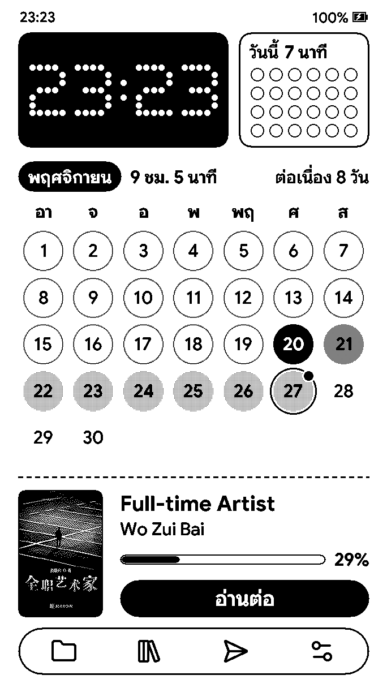
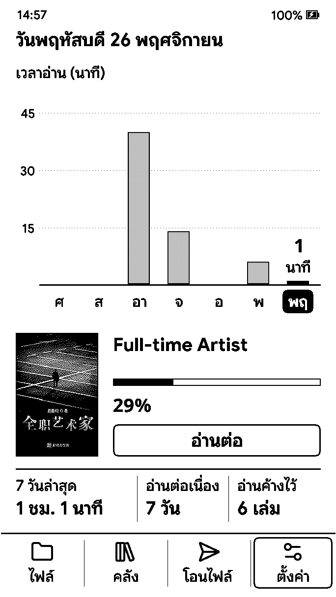
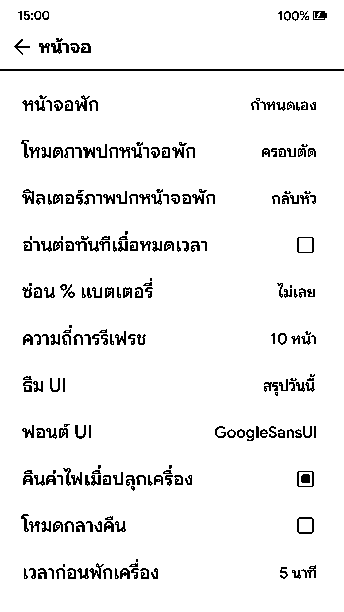

# CrossPoint Thai

CrossPoint Thai คือ fork ของ [CrossPoint Reader](https://github.com/crosspoint-reader/crosspoint-reader)
เฟิร์มแวร์ e-reader แบบ open source ที่เพิ่มการอ่านหนังสือภาษาไทยให้ถูกต้อง
พร้อมเมนูภาษาไทย ธีมหน้า Home แบบใหม่ บันทึกเวลาอ่าน และหน้าจอพักแบบปฏิทินไทย

**ติดตั้งในคลิกเดียว:** [thaitop.github.io/crosspoint-thai](https://thaitop.github.io/crosspoint-thai/)
(ทุกรุ่นที่ CrossPoint รองรับ)

ฟีเจอร์อื่นทั้งหมดมาจาก CrossPoint ต้นฉบับ (EPUB, ฟอนต์บน SD card, Wi-Fi, OPDS,
KOReader sync, plugin ฯลฯ) ดูรายละเอียดได้ที่
[README ของ upstream](https://github.com/crosspoint-reader/crosspoint-reader#readme)
และ [User Guide](./USER_GUIDE.md)

> โปรเจกต์นี้ไม่มีส่วนเกี่ยวข้องกับ Xteink, Metalio, Seeed, M5Stack, EEGO, Onyx หรือผู้ผลิตอุปกรณ์รายใด
> และไม่ใช่รุ่นทางการของ CrossPoint

---

## ภาพหน้าจอ

ภาพจาก Metalio E-Ink4-Plus

| หน้า Home: Calendar | หน้า Home: Shelf | หน้า Home: Ledger | หน้า Home: Today |
| :---: | :---: | :---: | :---: |
|  |  |  |  |

| อ่านหนังสือภาษาไทย | เมนูภาษาไทย | หน้าจอพักปฏิทินไทย |
| :---: | :---: | :---: |
|  |  |  |

---

## สิ่งที่เพิ่มเข้ามา

### การแสดงผลภาษาไทยในหนังสือ

- **วางวรรณยุกต์และสระบนให้ถูกตำแหน่ง** โดยไม่ต้องพึ่ง GPOS ของฟอนต์
  - สระบน วรรณยุกต์ ไม้หันอากาศ ฯลฯ ซ้อนกันได้ถูกต้อง
  - วรรณยุกต์ยกขึ้นพ้นนิคหิตของสระอำ
  - เครื่องหมายเลื่อนซ้ายเมื่ออยู่บนพยัญชนะหางสูง (ป ฝ ฟ)
  - ทำงานตอนวาด จึงใช้ได้กับฟอนต์บน SD card ด้วย
- **ตัดคำภาษาไทยด้วยพจนานุกรม** (อิงพจนานุกรมไทยของ ICU) ข้อความไทยใน EPUB
  ขึ้นบรรทัดใหม่ระหว่างคำ ไม่ตัดกลางคำ
- **ข้อความในเมนูไม่ขาดกลางตัวอักษร** เวลาย่อด้วย "…" จะไม่แยกพยัญชนะออกจากสระ/วรรณยุกต์
  และข้อความยาวจะตัดบรรทัดตามคำ

### เมนูภาษาไทย

- เพิ่มภาษา **ไทย** ในการตั้งค่าภาษา แปลข้อความเมนูครบทุกข้อความ
- ฟอนต์ UI ในตัว (Ubuntu) เพิ่มอักษรไทย U+0E01–U+0E5B จาก Noto Sans Thai (OFL)
- ตัวเลขในหน้าต่างปรับค่า (slider) ไม่กลายเป็นกล่องว่างเมื่อมีอักษรไทย
- การจัดย่อหน้าเริ่มต้นเป็น "ชิดซ้าย" เพราะการจัดเต็มบรรทัดทำให้ข้อความไทยมีช่องว่างกว้างผิดธรรมชาติ

### ธีมหน้า Home ใหม่ 4 แบบ

เลือกได้ที่ Settings → Display → UI Theme (หน้าจออื่นใช้สไตล์ Lyra)

- **Ledger** — หนังสือเล่มปัจจุบันขนาดใหญ่ พร้อมความคืบหน้าและปุ่มอ่านต่อ
  และหนังสือล่าสุดอีกไม่เกิน 10 เล่มแบบตารางความคืบหน้า
- **Today** — กราฟเวลาอ่าน 7 วันล่าสุด หนังสือเล่มปัจจุบัน
  เวลารวมของสัปดาห์ จำนวนวันที่อ่านต่อเนื่อง (streak) และหนังสือที่ยังอ่านไม่จบ
- **Calendar** (ค่าเริ่มต้นของเครื่องที่มีนาฬิกา; X4 รุ่นแรกที่ไม่มีนาฬิกาใช้ Lyra) — หน้า Home แบบปฏิทินที่วาดด้วยจุด
  - นาฬิกา HH:MM ตัวเลขจุดแบบ LED Counter 7
  - ช่อง "วันนี้" บอกเวลาที่อ่านวันนี้ และมีจุด 24 จุด (จุดละ 10 นาที)
  - ปฏิทินเดือน (สัปดาห์เริ่มวันอาทิตย์) วันที่อ่านแล้วเป็นวงกลมเข้มขึ้นตามเวลาอ่าน:
    เทาอ่อนเมื่อต่ำกว่า 60 นาที เทาเข้มเมื่อต่ำกว่า 120 นาที และสีดำเมื่อ 120 นาทีขึ้นไป
  - วันที่ผ่านมาแต่ไม่ได้อ่านมีวงเส้นเทาล้อม วันนี้มีวงล้อมและจุดดำมุมขวาบน
  - แตะวันที่ผ่านมาเพื่อดูเวลาที่อ่านของวันนั้น ถ้าไม่ได้แตะจะแสดงจำนวนวันที่อ่านต่อเนื่อง
  - หนังสือเล่มปัจจุบันปกมุมโค้ง แถบความคืบหน้าแบบแคปซูลพร้อมเปอร์เซ็นต์ ปุ่มอ่านต่อแบบแคปซูล
  - แถบเครื่องมือแบบแคปซูลด้านล่าง เหมือนธีม Shelf
- **Shelf (ชั้นหนังสือ)** — การ์ดหนังสือเล่มปัจจุบัน พร้อมแถบความคืบหน้าและปุ่มอ่านต่อแบบแคปซูล
  แถว "อ่านล่าสุด" ปกมุมโค้งไม่เกิน 9 เล่ม แสดงหน้าละ 3 เล่ม (จอแคบ 2 เล่ม)
  ปัดซ้าย/ขวาหรือกดเลื่อนเลยปกสุดท้ายเพื่อเปลี่ยนหน้า และแถบเครื่องมือแบบแคปซูลด้านล่าง
  - ตารางการอ่าน 30 วันล่าสุด (2 แถว แถวละ 15 วัน วันนี้อยู่มุมขวาล่าง) สีเข้มขึ้นตามเวลาอ่าน
    เหมือนธีม Calendar พร้อมเวลารวมและจำนวนวันที่อ่านใน 30 วัน
    (เก็บประวัติเริ่มจากเดือนปัจจุบันหลังอัปเดต; เครื่องที่ไม่มีนาฬิกาแสดงข้อความให้ตั้งนาฬิกา)
  - บรรทัด "วันนี้อ่าน N นาที · ติดต่อกัน N วัน" แสดงเฉพาะเครื่องที่มีนาฬิกา
    และเมื่อวันนี้มีเวลาอ่านหรือมีวันอ่านต่อเนื่อง

### บันทึกเวลาอ่าน

- นับเวลาระหว่างการเปลี่ยนหน้า ช่วงที่ห่างกันเกิน 5 นาทีนับแค่ 5 นาที
  (เปิดหนังสือค้างไว้จะไม่นับต่อ)
- บันทึกเวลาอ่านรายวันของสัปดาห์ล่าสุดและของเดือนปัจจุบัน รวมถึง streak
  ไว้ที่ `/.crosspoint/reading_log.json` บันทึกครั้งเดียวตอนออกจากหนังสือ
- จะเริ่มบันทึกเมื่อเครื่องตั้งเวลาแล้วเท่านั้น

### หน้าจอพักแบบปฏิทินไทย

เลือกได้ที่ Settings → Display → Sleep Screen → **Thai Calendar** หรือ **Thai Calendar (Dark)**

- ปี พ.ศ. และปีนักษัตร เดือนและวันในสัปดาห์ วันที่ตัวใหญ่
- ภาพดวงจันทร์ตามข้างขึ้นข้างแรมจริงของวันนั้น
- วันทางจันทรคติ เช่น `ขึ้น 4 ค่ำ เดือน 12` คำนวณในเครื่อง ไม่ต้องใช้อินเทอร์เน็ต
  (ตารางปีจันทรคติ พ.ศ. 2568–2591 ตรวจกับวันหยุดทางพุทธศาสนาที่ประกาศจริง)
- แถบสัปดาห์ปัจจุบัน และวันสำคัญที่กำลังจะมาถึงพร้อมจำนวนวันที่เหลือ
- ข้อความเป็นภาษาไทยเมื่อเมนูเป็นภาษาไทย นอกนั้นเป็นภาษาอังกฤษ
- ถ้าเครื่องยังไม่ได้ตั้งเวลา จะแสดงหน้าจอพักแบบปกติแทน
- หน้าจอวาดครั้งเดียวตอนเข้าโหมดพัก ถ้าพักข้ามเที่ยงคืนจะยังแสดงวันเดิม

### เฉพาะ Metalio E-Ink4-Plus (branch `thai-eink4plus`)

- ไอคอนและฟอนต์ UI ความละเอียดสูง (ขนาด 12/15/18 pt) ตาม upstream 2.1 RC
- ฟอนต์ UI ปกติใช้น้ำหนัก Medium ให้ตัวหนังสือในเมนูเข้มขึ้นบนจอเฉดเทา
- จอกระพริบครั้งเดียวต่อการเปลี่ยนหน้าจอ และไม่กระพริบตอนออกจากหนังสือกลับหน้า Home
- เมนูมีเฉพาะภาษาอังกฤษและภาษาไทย เพื่อให้ firmware พอดีกับพื้นที่ flash
  (เครื่องที่ตั้งภาษาอื่นไว้จะแสดงภาษาอังกฤษ)

---

## Branch และอุปกรณ์

| Branch | ฐานจาก upstream | อุปกรณ์ | ทดสอบบนเครื่องจริง |
| --- | --- | --- | --- |
| `thai-2.0.0` | tag `2.0.0` | ทุกบอร์ดที่ upstream 2.0.0 รองรับ | Xteink X4 Pro |
| `thai-eink4plus` | `feat-metalio-eink4plus` (2.1 RC) | Metalio E-Ink4-Plus เท่านั้น | Metalio E-Ink4-Plus |

บอร์ดอื่นใน `thai-2.0.0` build ผ่าน แต่ยังไม่ได้ทดสอบบนเครื่องจริง

งานไทยเก็บเป็น commit แยกตามหัวข้อบน tag ของ upstream
เมื่อ upstream ออกเวอร์ชันใหม่ จะ rebase commit ชุดนี้ไปบน tag ใหม่

---

## ดาวน์โหลด

ถ้าไม่ได้ build เอง ให้ติดตั้ง[ผ่านหน้าเว็บ](#ผ่านหน้าเว็บ-แนะนำ) ไม่ต้องโหลดไฟล์

ไฟล์เฟิร์มแวร์ที่ build แล้วอยู่ที่หน้า [Releases](https://github.com/thaitop/crosspoint-thai/releases)
แต่ละ release มีไฟล์ของทุกรุ่น ชื่อไฟล์ขึ้นต้นด้วยรหัสรุ่น:

| รหัส | อุปกรณ์ |
| --- | --- |
| `x4pro` | Xteink X4 Pro |
| `eink4plus` | Metalio E-Ink4-Plus |
| `x3-x4` | Xteink X3 / X4 |
| `x4c` | Xteink X4 Classic (X4C) |
| `sticky` | Seeed Sticky |
| `papermono` | M5Stack Paper Mono |
| `metalio_eink4` | Metalio E-Ink 4 |
| `eego_a4` | EEGO Reader A4 |
| `picco` | Onyx Picco / BOOX Tiles |

| ไฟล์ | ใช้ทำอะไร |
| --- | --- |
| `<รหัส>-firmware.bin` | อัปเดตผ่าน SD card หรือ flash ผ่าน USB ที่ offset 0x10000 (Picco: 0xE0000) |
| `<รหัส>-firmware.factory.bin` | flash ผ่าน USB ที่ offset 0x0 \* (ไม่มีของ Picco) |

\* ไฟล์ `factory.bin` เขียนทับพื้นที่ NVS ด้วย จึงล้างข้อมูลที่เครื่องเก็บไว้
เช่น รหัสเครื่องที่ใช้เปิดหนังสือที่มีการป้องกัน หน้าเว็บติดตั้งจะข้ามพื้นที่นี้ให้

Picco ต้องไม่ flash ที่ offset 0x0 เพราะจะเขียนทับ bootloader และโหมดกู้คืนของผู้ผลิต

---

## Build

### เตรียมเครื่อง

```bash
git clone --recursive https://github.com/thaitop/crosspoint-thai
cd crosspoint-thai
git checkout thai-2.0.0        # หรือ thai-eink4plus
git submodule update --init --recursive
```

ติดตั้ง [pioarduino PlatformIO Core](https://github.com/pioarduino/platformio-core)
ตาม [getting started](./docs/contributing/getting-started.md)

- `thai-2.0.0` ใช้ pioarduino **6.1.19** (6.2.0 ทำให้ env `default`, `slim`, `sticky` build ไม่ผ่าน)
- `thai-eink4plus` ใช้ pioarduino **6.2.0** ถ้าต้องใช้ทั้งสอง branch
  ให้แยก core dir ด้วย `PLATFORMIO_CORE_DIR`

### คำสั่ง build

```bash
# Xteink X4 Pro
pio run -e x4pro

# Xteink X3/X4
pio run -e default

# Metalio E-Ink4-Plus (branch thai-eink4plus)
PLATFORMIO_CORE_DIR=~/.platformio-eink4plus pio run -e metalio_eink4_plus
```

ดูชื่อ env ของบอร์ดอื่นได้ใน `platformio.ini`
ไฟล์ที่ได้อยู่ที่ `.pio/build/<env>/firmware.bin`

เมื่อเปลี่ยน branch ฐาน ถ้า pio error ตอนลบ library เก่า ให้ลบ `.pio/libdeps/<env>` แล้ว build ใหม่

---

## ติดตั้งเฟิร์มแวร์

### ผ่านหน้าเว็บ (แนะนำ)

1. ต่อเครื่องเข้าคอมพิวเตอร์ด้วยสาย USB-C
2. เปิด [thaitop.github.io/crosspoint-thai](https://thaitop.github.io/crosspoint-thai/)
   ด้วย Chrome หรือ Edge บนคอมพิวเตอร์
3. เลือกรุ่นของเครื่อง กด **ติดตั้งลง <รุ่น>** เลือกพอร์ตของเครื่อง แล้วรอจนขึ้น "ติดตั้งเสร็จแล้ว"
   ระหว่างนี้ห้ามถอดสาย

หน้าเว็บติดตั้ง release ล่าสุดเสมอ การตั้งค่าและหนังสือในเครื่องยังอยู่ครบ
Safari, Firefox และมือถือยังใช้หน้านี้ไม่ได้ เพราะไม่มี Web Serial

### ผ่าน SD card (เครื่องที่ลง CrossPoint ไว้แล้ว ยกเว้น Picco)

1. คัดลอก `firmware.bin` ไปไว้ที่ root ของ SD card
   (ถ้าโหลดจาก Releases ให้เปลี่ยนชื่อ `<รหัส>-firmware.bin` เป็น `firmware.bin`)
2. บนเครื่อง ไปที่ Settings → General → SD Card Firmware Update

### ผ่าน USB

ต่อเครื่องด้วยสาย USB-C แล้วใช้

```bash
pio run -e <env> -t upload
```

หรือใช้ Custom .bin ใน [web flasher](https://crosspointreader.com/#flash-tools)
อุปกรณ์ Xteink ที่ล็อก USB มาจากโรงงานดูวิธีปลดล็อกได้ที่
[README ของ upstream](https://github.com/crosspoint-reader/crosspoint-reader#usb-locked-devices-xteink-unlocker)

### กลับไปใช้เฟิร์มแวร์เดิม

flash CrossPoint รุ่นทางการ หรือเฟิร์มแวร์ของผู้ผลิต ผ่าน
[web flasher](https://crosspointreader.com/#flash-tools)

---

## ตั้งค่าให้ใช้ภาษาไทย

1. Settings → General → Language → **ไทย**
2. ตั้งเวลาเครื่องที่ Settings → General → Clock เพื่อให้บันทึกเวลาอ่านและปฏิทินไทยทำงาน
3. หนังสือไทยใช้ฟอนต์ที่มีอักษรไทย เช่น ใส่ฟอนต์ไทยบน SD card ตาม
   [SD card font guide](./docs/sd-card-fonts.md)

cache layout ของบทหนังสือถูกเพิ่มเวอร์ชันแล้ว หนังสือที่เคยเปิดด้วยเฟิร์มแวร์เดิม
จะจัดหน้าใหม่อัตโนมัติเมื่อเปิดครั้งแรก

---

## สำหรับนักพัฒนา

- Host test: `test/thai_word_break/`, `test/thai_calendar/` และ test อื่นของ upstream
  ดู [testing workflow](./docs/contributing/README.md)
- เอกสารออกแบบและแผนงานของฟีเจอร์ไทย: [`docs/superpowers/specs/`](./docs/superpowers/specs/)
  และ [`docs/superpowers/plans/`](./docs/superpowers/plans/)
- พจนานุกรมตัดคำสร้างจาก `scripts/generate_thai_dictionary.py`
- ฟอนต์ UI สร้างจาก `lib/EpdFont/scripts/convert-builtin-fonts.sh`
- การพัฒนาทั่วไป: [contributing docs](./docs/contributing/README.md)

---

## License และเครดิต

- โค้ดอยู่ภายใต้ license เดียวกับ CrossPoint Reader ดู [LICENSE](./LICENSE)
- อักษรไทยในฟอนต์ UI: Noto Sans Thai (SIL Open Font License)
- ตารางปีจันทรคติไทย: [python-holidays](https://github.com/vacanza/holidays) (MIT)
- พจนานุกรมตัดคำ: ICU `thaidict.txt` (Unicode License V3)
- ขอบคุณ [CrossPoint Reader](https://github.com/crosspoint-reader/crosspoint-reader)
  และชุมชนผู้พัฒนา
